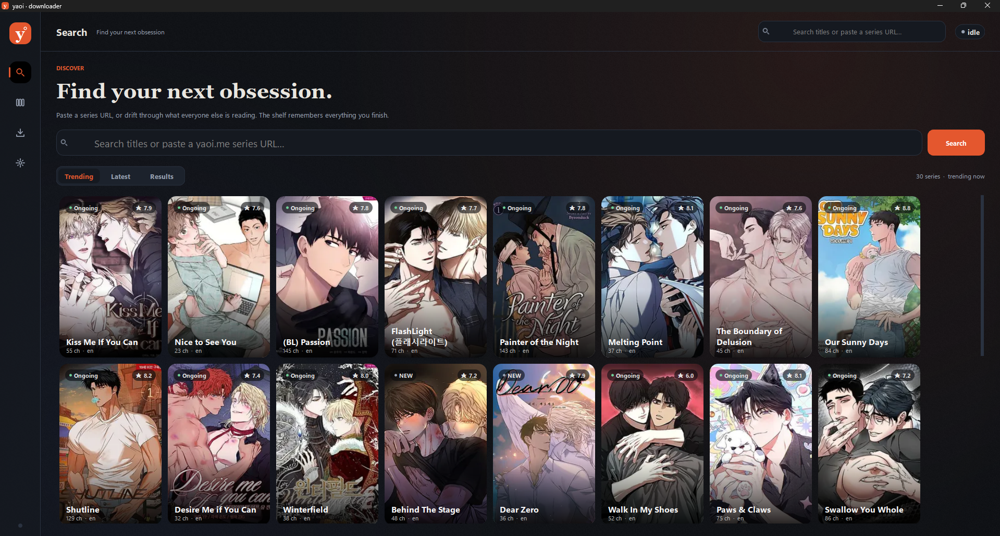

<div align="center">

# yaoi-downloader

**A manga downloader to download manga from https://yaoi.me/.**

[](https://www.python.org/)
[](https://www.riverbankcomputing.com/software/pyqt/)
[](https://typer.tiangolo.com/)
[](LICENSE)

[GitHub](https://github.com/Yui007/yaoi-downloader) · [Features](#features) · [Setup](#setup) · [Usage](#usage)

</div>



Paste a series URL. Choose chapters with the same grammar in the app and the
CLI. Get a clean, reader-ready CBZ, a PDF, or a folder of raw images.

One core powers both faces: the same source adapter, selection engine,
downloader, and exporter. The heavy lifting is shared, so neither face drifts.

---

## Features

| | |
|---|---|
| **One paste** | URL → metadata → every chapter. No forms, no searching twice. |
| **Honest progress** | A bar per chapter, a page counter, real bytes, live speed, working pause and cancel. |
| **Your shelf** | An active queue plus a finished library with covers, sizes, and folder reveal. |
| **Any shape out** | Raw images, PDF, or CBZ. Keep the intermediate images if you want them. |
| **Reader-ready** | CBZ archives carry `ComicInfo.xml` first, so Kavita, Komga, and most readers file them correctly. |
| **Resumable** | Page-level resume, HTTP cache, retries with jitter, and `Retry-After` support. |
| **Local-first** | `settings.json`, `keys.json`, cache, downloads, and library all live inside the project. No AppData, no home-directory config. |
| **Two faces** | A PyQt6 desktop app with Ink & Paper themes, and a Typer + Rich CLI with a guided wizard and JSON events. |

## Setup

### Requirements

- **Python 3.10+** — 3.11 recommended
- Windows, macOS, or Linux (developed and tested on Windows)
- An internet connection to reach the catalogue and reader

### Install

```powershell
git clone https://github.com/Yui007/yaoi-downloader.git
cd yaoi-downloader

python -m venv .venv

# Windows (PowerShell)
.venv\Scripts\Activate.ps1

# macOS / Linux
source .venv/bin/activate

python -m pip install --upgrade pip
python -m pip install -e ".[gui]"
```

For development, install the test tools too:

```powershell
python -m pip install -e ".[gui,dev]"
```

> **PowerShell blocks activation?** Use the interpreter directly:
> `.venv\Scripts\python.exe -m pip install -e ".[gui]"`

### First run

```powershell
yaoi-gui        # desktop app
yaoi gui        # the same app from the CLI
yaoi            # guided CLI wizard
```

The app writes `settings.json` on the first change and on close; missing values
fall back to sensible defaults. Reader keys are recovered automatically and
stored in `keys.json`; neither file is committed.

## Usage

### GUI

The app has four rooms:

| Room | What it does |
|---|---|
| **Search** | Trending, latest, and title search in a cover grid. Paste a URL here too. |
| **Series** | Metadata, scanlator/language filters, the selection grammar, live chapter bars, and a sticky download bar. |
| **Library** | Active queue with pause/cancel/reveal, and finished series with covers and sizes. |
| **Settings** | Ink or Paper theme, reduce motion, font scale, formats, workers, folders, network, cache, and reader keys. |

Keyboard shortcuts:

| Keys | Action |
|---|---|
| `Ctrl+K` | Focus search |
| `Ctrl+1` … `Ctrl+4` | Search · Library · Queue · Settings |
| `Ctrl+,` | Settings |
| `Esc` | Back, or clear the search field |

### CLI

```powershell
yaoi search "kiss me"
yaoi trending --limit 10
yaoi latest --limit 10
yaoi info "https://yaoi.me/series/50807/kiss-me-if-you-can"

yaoi download "https://yaoi.me/series/50807/kiss-me-if-you-can" -c 1,5,10-20 -f cbz
yaoi download "https://yaoi.me/series/50807/kiss-me-if-you-can" -c all -f pdf
yaoi download "https://yaoi.me/series/50807/kiss-me-if-you-can" -c 3 -f images --keep-images

yaoi library
yaoi keys check
```

#### Chapter grammar

```text
all              every visible chapter
*                same as all
5                chapter 5
23.5             a decimal label
1-50             an inclusive range
5.5-15.5         decimal range
1,5,10-20        union, sorted and de-duplicated
20-10            reversed ranges are normalised
```

Selection always applies *after* the scanlator and language filters, so `1`
means the first chapter you can actually see.

#### Download flags

| Flag | Meaning |
|---|---|
| `-c, --chapters` | `"1,5,10-20"`, a single chapter, or `all`. |
| `-f, --format` | `images`, `pdf`, or `cbz`. |
| `-o, --out` | Library root for this run. |
| `--keep-images` / `--clean-images` | Keep or remove the downloaded page files after export. |
| `--source` | Filter by scanlator name. |
| `--lang` | Filter by language code, for example `en`. |
| `--chapters-workers` | Concurrent chapters, `1`–`8`. |
| `--images-workers` | Concurrent images per chapter, `1`–`10`. |
| `--yes` | Never prompt. Required when there is no TTY. |
| `--force` | Re-download pages that already exist. |
| `--json` | One JSON event per line: job → chapter → summary. |

Exit codes are stable: `0` success, `1` download/export/network failure,
`2` validation or source error, `3` reader-key failure, `130` cancelled.

## Output

```text
library/
└── Kiss Me If You Can/
    ├── cover.jpg
    ├── Kiss Me If You Can - Ch.55.cbz
    └── Kiss Me If You Can - #515.pdf
```

Work in progress stays resumable under `downloads/`, grouped by series and
chapter. A cancelled download leaves its pages in place for the next run.

## Configuration

Everything lives beside the checkout:

| Path | Purpose |
|---|---|
| `settings.json` | Theme, format, workers, folders, network and cache preferences. Written atomically. |
| `keys.json` | Verified reader constants. Recovered and refreshed when the site redeploys. |
| `cache/` | Listings, covers, and reader responses. |
| `downloads/` | Resumable page work. |
| `library/` | Finished books. |
| `logs/` | Optional runtime logs. |

CLI flags beat environment variables, which beat `settings.json`:

| Variable | Example |
|---|---|
| `YAOI_UI_THEME` | `ink` or `paper` |
| `YAOI_DOWNLOAD_FORMAT` | `cbz`, `pdf`, `images` |
| `YAOI_DOWNLOAD_CHAPTERS_WORKERS` | `4` |
| `YAOI_DOWNLOAD_IMAGES_WORKERS` | `6` |
| `YAOI_NETWORK_TIMEOUT` | `40` |

If reader keys drift, the app will say so. Check and refresh them with:

```powershell
yaoi keys check
yaoi keys refresh
```

## Project layout

```text
yaoi/
├── config.py          settings, project paths, atomic writes
├── models.py          Series, ChapterGroup, Variant, JobEvent
├── selection.py       "1,5,10-20" → indexes
├── filters.py         scanlator/language filters and re-indexing
├── downloader.py      two pools, global brake, resume, cancel
├── http.py            retries, jitter, cache, atomic page writes
├── sources/           yaoi.me adapter, signed reader, key recovery
├── export/            images, PDF, CBZ, ComicInfo.xml
├── cli/               Typer commands, wizard, Rich progress
└── gui/               theme, bridge, models, widgets, views

tests/                 offline pytest suite
GUI.png                the screenshot above
```

## Tests

The suite runs offline:

```powershell
.venv\Scripts\python -m pytest
```

It covers the selection grammar, filters, settings corruption and merge,
ComicInfo, CBZ/PDF output, download resume and cancellation, RSC parsing, and
a PyQt6 GUI smoke test.

## Legacy scripts

- `basic.py` still works on its own for a single latest chapter.
- `refresh_keys.py` is now a thin wrapper around `yaoi/sources/keys.py`; it
  writes the same `keys.json` the app reads.

## Notes

This is a personal archive tool, not a streaming service. It is not affiliated
with yaoi.me. Use it only for material you are allowed to access, respect the
site's terms and the rights of the creators, and follow the law where you live.
The catalogue contains adult material: **18+ only**.

Built with [Typer](https://typer.tiangolo.com/), [Rich](https://rich.readthedocs.io/),
[PyQt6](https://www.riverbankcomputing.com/software/pyqt/), Pillow, pypdf,
img2pdf, cryptography, and requests.

## License

[MIT](LICENSE) © yaoi-downloader contributors
